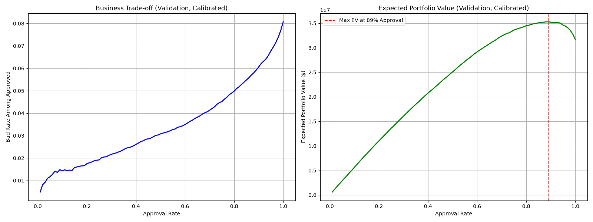

# Credit Risk Modelling: Decision-Support Tool

## Overview
Lending money is a balancing act between capturing revenue from good loans and minimizing losses from defaults. The goal of this project is to go beyond building a simple machine learning classifier; instead, we developed a **decision-support tool** that directly bridges the gap between predictive modeling and business strategy. 

Using historical loan application data (the [Home Credit Default Risk dataset](https://www.kaggle.com/datasets/megancrenshaw/home-credit-default-risk)), we trained a model to predict the likelihood of a loan default. Rather than simply evaluating this model on arbitrary data science metrics, we translated the model's output into business terms: **Approval Rate vs. Bad Debt Rate** and **Expected Portfolio Value**. This enables the Credit Strategy team and Lending Committee to make data-driven, risk-adjusted decisions on loan approvals.

### Setup and Reproducibility
To reproduce the findings in this repository:
1. **Clone the repo** and navigate to the root directory.
2. **Create a virtual environment**: `python3 -m venv .venv && source .venv/bin/activate`
3. **Install dependencies**: `pip install -r requirements.txt`
4. **Download the data**: See instructions in `data/README.md` to download `application_train.csv`.
5. **Run the analysis**: Either run the pre-built script via `python3 run_metrics.py`, or open `Credit_Risk_Analysis.ipynb` in Jupyter Notebook.

---

## 1. The Problem & Data Strategy
The dataset exhibits a heavy class imbalance: historically, only about 8% of applicants default on their loans. In this scenario, traditional metrics like "Accuracy" are highly misleading—a naive model that simply rejects every applicant would be 92% "accurate" but would instantly bankrupt a lending business by generating zero revenue. 

The true challenge is **ranking risk** accurately. 

### Rigorous Evaluation Split
To prevent data leakage and provide an honest assessment, we utilized a strict **3-way split**:
- **Train (60%)**: Used exclusively for model fitting and 5-fold cross-validation hyperparameter search.
- **Validation (20%)**: Used for probability calibration, threshold selection, and expected-value simulation.
- **Test (20%)**: A completely held-out set evaluated exactly once to report the final, unbiased headline metric.

*(Note: Because the dataset lacks application dates, a true out-of-time backtest isn't possible here. We used stratified k-fold cross-validation on the train set to gauge score stability, but this remains a spatial, rather than temporal, generalization).*

## 2. Modeling & Calibration

We utilized **XGBoost**, utilizing a randomized search over cross-validated AUC-PR (Precision-Recall) to find optimal hyperparameters.

To handle the 8% imbalance and produce usable probabilities, we employed a two-step process:
1. **`scale_pos_weight`**: We set this parameter in XGBoost to reweight the loss function, penalizing minority class (default) errors. This fixes the model's *ranking* ability under imbalance.
2. **Probability Calibration**: Reweighting loss can distort the actual predicted probability scale. To ensure our output probabilities are financially meaningful (i.e., a 10% score actually means a 10% chance of default), we applied **Isotonic Regression** (Platt Scaling's non-parametric alternative) on the validation set. 
- *Calibration improved our Brier score, making the subsequent Expected Value math sound.*

## 3. The Business Trade-off (Validation Set)

A predictive model outputs a probability of default. The Credit Strategy team must choose a **cutoff threshold**: applicants below this risk threshold are approved, and those above are rejected.

### Expected Value Framing
To find the optimal threshold, we simulated the **Expected Portfolio Value** assuming rough financial figures: a profit of **$1,000** for every good loan and a loss of **-$5,000** for every default.

Under these assumptions, the expected portfolio value peaks near an **89% approval rate on the validation set**. When we take the threshold associated with that 89% peak and apply it completely untouched to the **held-out Test Set**, we achieve an **88.6% approval rate**, generating a similar expected portfolio value.

**Crucial Caveats:** *This should be read as illustrative of the framework, not a validated lending policy.*
1. **Assumed Unit Economics:** The +$1000 / -$5000 figures are purely hypothetical.
2. **No Time-Based Validation:** We are validating on a random holdout, not a future time period.
3. **Calibration is Assumption-Dependent:** Our Isotonic Regression assumes the validation set's distribution perfectly mirrors the future population.
4. **Single Population Snapshot:** Real-world portfolios suffer from macroeconomic drift, which this single static dataset cannot capture.

## 4. Fairness Audit

In a real lending environment, models must comply with fair lending regulations (e.g., ECOA in the US). Even without a full disparate impact audit, we must acknowledge that certain features (like `CODE_GENDER`) are protected classes. 

Using `CODE_GENDER` strictly as group labels for a post-scoring audit (not as model inputs), we evaluated the **Disparate Impact Ratio** (DIR), which is the approval rate of the lower-approval group divided by the higher-approval group. 

In our validation, the model produced a Disparate Impact Ratio of **0.8711**. Because this clears the common **80% "four-fifths rule"** reference point used in US employment/lending screens, it does not immediately flag as adverse impact under that specific benchmark. However, the ~13% gap would still warrant rigorous investigation by a compliance team before any deployment.

## Repository Contents
- `Credit_Risk_Analysis.ipynb`: The primary Jupyter Notebook for presentation.
- `src/`: Reusable Python modules (`data.py`, `features.py`, `train.py`, `evaluate.py`, `business_metrics.py`) containing the core logic.
- `run_metrics.py`: The reproducible script used to train the models, run the sweeps, and generate metrics.
- `requirements.txt`: Python dependencies.
